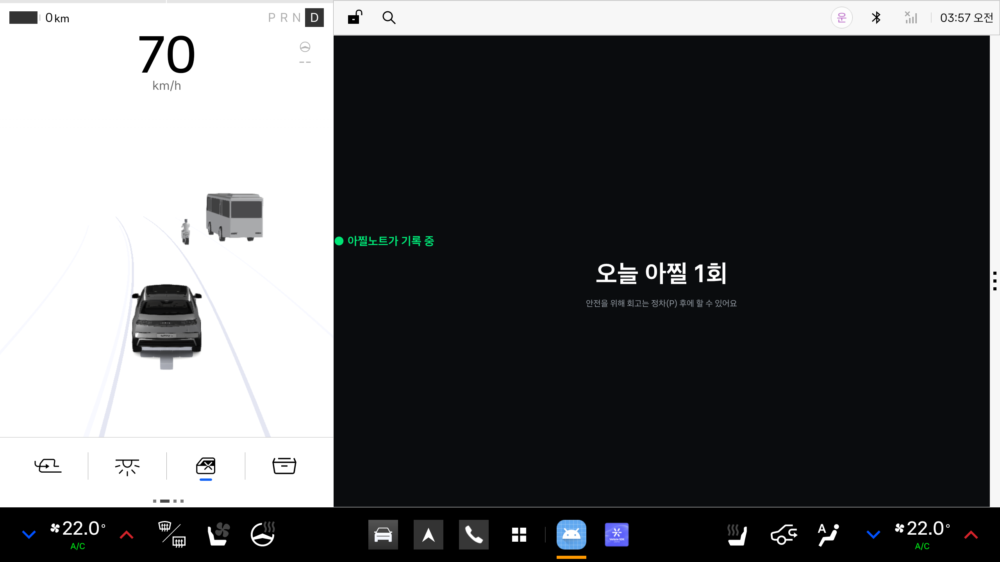
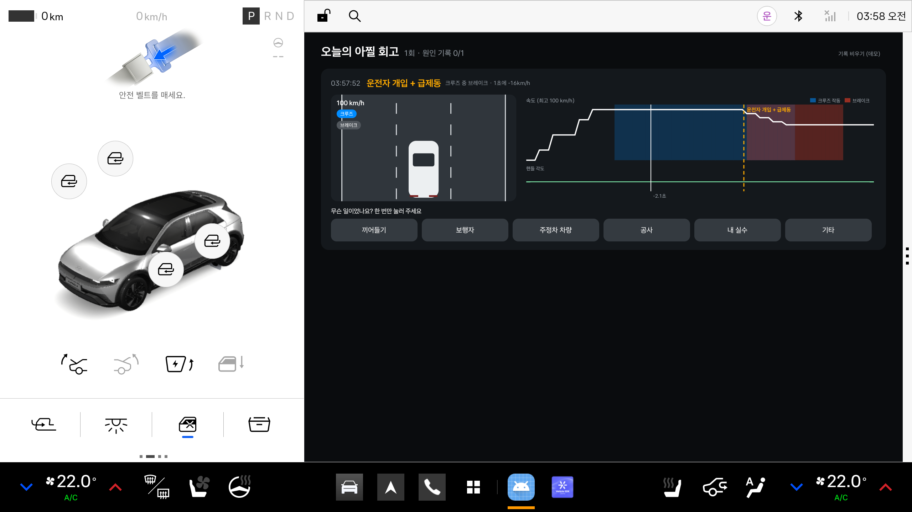
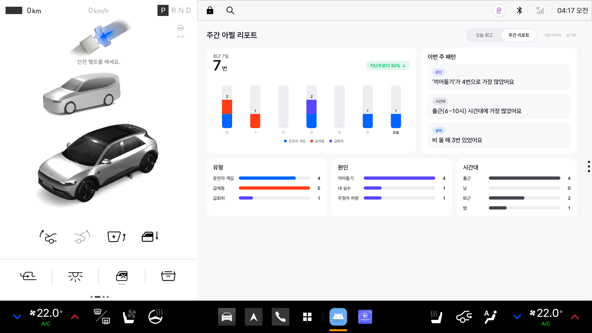

# 아찔노트 (Acchil Note)

차량 신호로 '사고 날 뻔한 순간'을 스스로 기록하고, 정차 후 한 번의 터치로 원인을 남기면, 다음에 그 구간에 다가갈 때 차가 먼저 말해 주는 차량 전용 아차사고 노트입니다.

현대자동차그룹 차량용 앱 개발 공모전 출품작 · Pleos Connect (Android Automotive 14)

| 주행 중 | 정차 후 회고 | 주간 리포트 |
|---|---|---|
|  |  |  |

시연 영상: [docs/demo.mp4](docs/demo.mp4) (33초). 실제 앱 화면은 에뮬레이터 녹화이고, 도로 장면과 ③ 아찔 구간 예고는 일러스트·콘셉트 화면입니다.

## APK

**[`apk/아찔노트_release.apk`](apk/아찔노트_release.apk)** · release 빌드, 서명됨, 패키지 `ai.acchil.note`, versionName 0.2.0

## 기능

- **주행 중 (D/R/N)**: 화면 조작 없이 "기록 중 · 오늘 아찔 N회"만 표시합니다. 차량 신호로 아래 순간을 자동 감지합니다.
  - 운전자 개입: 크루즈 작동 중 브레이크, 또는 크루즈 작동 → 해제
  - 급제동: 1초 안에 14km/h 이상 감속 (약 0.4g, 일반 정차는 제외)
  - 급회피: 0.5초 안에 핸들 90° 이상
  - 상황 태그: 와이퍼 → 비, 전조등 → 야간, 3초 안 방향지시등 → 차로 변경 중
- **정차 중 (P)**: 오늘의 아찔 회고 카드. 그 순간의 앞 5초·뒤 3초를 실제 기록값(속도·브레이크·크루즈·핸들)으로 재생하고, 원인(끼어들기 / 보행자 / 주정차 차량 / 공사 / 내 실수 / 기타)을 한 번 터치로 남깁니다.
- **주간 리포트**: 최근 7일 횟수와 지난주 대비 변화, 요일·유형·원인·시간대 막대, 패턴 문장.
- 기록은 기기 안에만 저장합니다. 영상·음성·연락처는 수집하지 않습니다.

## 테스트 환경

| 항목 | 값 |
|---|---|
| 에뮬레이터 | **Pleos Connect Emulator v2.1.0** (시스템 이미지 `system-images;android-34;pleos_car_emulator;arm64-v8a`) |
| 화면 규격 | **2560 × 1440** (기기 정의 `Pleos Connect v2.1.0`) |
| AVD 설정 | RAM 4GB, Cold boot (Quick boot이면 VHAL이 동작하지 않음) |
| 차량 신호 입력 | 에뮬레이터 내장 Virtual Console (`http://127.0.0.1:8088`) |
| 개발 환경 | macOS (Apple Silicon), JDK 17, Android SDK 35, Gradle 8, Kotlin |
| SDK | Pleos Vehicle SDK 2.3.2, AAOS Car API (`PERF_VEHICLE_SPEED`) |

에뮬레이터 설치는 Pleos 공식 가이드를 따릅니다: [Pleos Connect 개발 환경 설정](https://document.pleos.ai/docs/connect/guide/getting-started/application-development/setup-connect-sdk-emulator)

## 실행 방법

### 1. APK 설치·실행

에뮬레이터를 켠 뒤:

```bash
adb install -r "apk/아찔노트_release.apk"
U=$(adb shell am get-current-user | tr -d '\r')
adb shell pm grant --user $U ai.acchil.note android.car.permission.CAR_SPEED   # 차속 권한 (팝업 대신)
adb shell am start --user $U -n ai.acchil.note/.MainActivity
```

앱 서랍에서 "아찔노트"를 눌러도 됩니다. 차속 권한을 주지 않으면 급제동 감지만 빠지고 나머지는 동작합니다.

### 2. 아찔 상황 재현

Virtual Console을 스크립트로 조작해 상황을 재현합니다. `adb`가 PATH에 있어야 합니다.

```bash
scripts/scenario.sh cutin    # 고속도로 크루즈 100km/h 중 끼어들기 → 브레이크 (운전자 개입 + 급제동)
scripts/scenario.sh swerve   # 비 오는 밤 이면도로 급회피
scripts/scenario.sh end      # 서서히 정차 → P (회고 카드 표시)
scripts/scenario.sh all      # 위 셋을 차례로
scripts/scenario.sh reset    # 초기화
```

`cutin` 다음 `end`를 실행하면 정차 후 회고 카드가 뜹니다. "끼어들기"를 누르면 끼어든 차가 장면에 점선으로 나타납니다.
Virtual Console을 브라우저(`adb forward tcp:8088 tcp:8088` 후 `http://127.0.0.1:8088`)에서 직접 조작해도 됩니다.

정차 화면 오른쪽 위 "시연 데이터"는 지난 2주치 예시 기록을 채웁니다. "초기화"는 모든 기록을 지웁니다.

### 3. 소스에서 빌드

```bash
./gradlew assembleRelease     # app/build/outputs/apk/release/app-release.apk
```

- Pleos Maven 저장소(`https://nexus-playground.pleos.ai/repository/maven-releases/`)는 `settings.gradle.kts`에 들어 있습니다.
- 서명 키는 저장소에 없습니다. `-PkeystoreProps=<keystore.properties 경로>`를 주면 그 키로, 주지 않으면 디버그 키로 서명합니다.
- `local.properties`에 `sdk.dir`를 지정하거나 `ANDROID_HOME`을 설정해 주세요.

## 필요한 권한

| 권한 | 용도 |
|---|---|
| `pleos.car.permission.CAR_DRIVE`, `READ_ADAS_STATES` | 기어, 브레이크, 크루즈 상태 |
| `pleos.car.permission.READ_CAR_STEERING` | 조향각 |
| `pleos.car.permission.CAR_LIGHTS`, `CAR_WINDOWS`, `READ_WINDSHIELD_WIPERS` | 전조등, 방향지시등, 와이퍼 |
| `android.car.permission.CAR_SPEED` | 차속 (런타임 권한) |

주행 중에도 상태 표시가 보이도록 `distractionOptimized` 메타데이터를 선언했습니다. 주행 중 화면에는 조작 요소가 없습니다.

## 구조

| 파일 | 역할 |
|---|---|
| `MainActivity.kt` | Vehicle SDK·AAOS 차속 구독, 100ms 샘플링, 주행/정차 화면 전환 |
| `AcchilDetector.kt` | 감지 규칙 |
| `Moment.kt` | 앞 5초 + 뒤 3초 신호 저장, 기기 내 JSON 저장 |
| `ReplayView.kt` | 회고 장면·그래프 재생 |
| `Report.kt` | 주간 집계와 패턴 문장 |
| `Design.kt` | Pleos Connect UI Design Guide 색 토큰(낮·밤), 서체 Asta Sans |

## 에뮬레이터 검증 결과

| 시나리오 | 감지 |
|---|---|
| cutin: 크루즈 100km/h → 브레이크 80% | 운전자 개입(크루즈 중 브레이크), 급제동 −16km/h/1s |
| swerve: 비·야간, 핸들 급조작 | 급회피 Δ−110°, 태그: 비·야간 |
| end: 서서히 정차 → P | 운행 종료 → 회고 카드 (일반 정차는 급제동으로 잡지 않음) |

Virtual Console 크루즈 모드와 SDK 값의 대응: `full_autonomous` → `ACTIVATED`, `ready`/`longitudinal`/`lateral` → `ENABLED`, `not_ready` → `null`.

## 다음 단계 (2차 PT 전)

- FusedLocation SDK로 아찔 순간의 위치 저장, 회고 카드에 지도 궤적
- 아찔 구간 예고: 원인을 남긴 지점 300m 앞에서 TextToSpeech로 음성 한 마디
- NaviHelper로 출발 전 경로 브리핑
- 실주행 기록을 에뮬레이터에 재생하는 검증 환경

## 라이선스

서체 Asta Sans는 SIL Open Font License 1.1을 따릅니다 (`app/src/main/assets/fonts/AstaSans-OFL.txt`).
